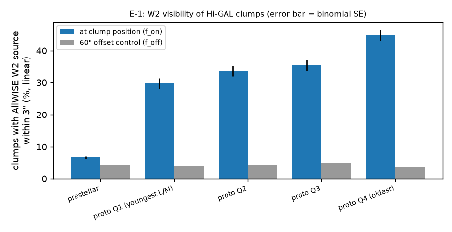
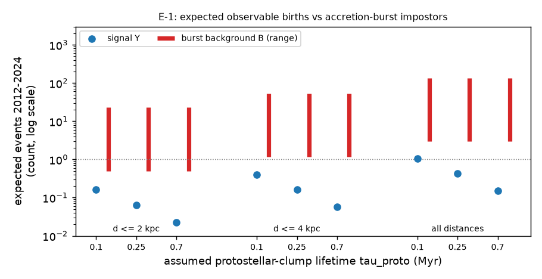

# Feasibility: can archival W1/W2 data catch a prestellar clump turning protostellar?

Question: before building the E1 pipeline, is the expected number of *observable*
prestellar->protostellar turn-ons in the Hi-GAL sample large enough, and larger
than the accretion-burst impostors that mimic them? Literature and parameter
sources: [LITERATURE.md](LITERATURE.md). Terms: glossary at the end.

## E-1(B) Detectability of the post-transition state at 4.6 um

**Hypothesis.** If a newborn protostar is visible in W2, Hi-GAL *protostellar*
clumps (the post-transition state) show a W2 point source at the clump position
more often than the chance-alignment rate; the youngest ones (lowest L/M) set
the detectability of a fresh turn-on. Prediction: excess df_W2 > 0.05.

**Test.** Random 4,000 prestellar + 4,000 protostellar clumps (all distances),
nearest AllWISE source within 3" with w2snr >= 5, server-side IRSA TAP upload;
control = same positions +60" in Dec.

| grp                     |    n |   f_on |   f_off |   excess |   se_on |
|:------------------------|-----:|-------:|--------:|---------:|--------:|
| prestellar              | 4000 | 0.067  |  0.0442 |   0.0228 |  0.004  |
| proto Q1 (youngest L/M) |  842 | 0.2969 |  0.0392 |   0.2577 |  0.0157 |
| proto Q2                |  842 | 0.3361 |  0.0428 |   0.2933 |  0.0163 |
| proto Q3                |  841 | 0.3532 |  0.0511 |   0.302  |  0.0165 |
| proto Q4 (oldest)       |  842 | 0.4477 |  0.038  |   0.4097 |  0.0171 |

**Result — confirmed.** Youngest-quartile protostellar clumps: df_W2 =
0.258; all protostellar 0.316; chance rate
f_off = 0.044. Prestellar clumps already show a small excess
f_prehost = 0.023 (sources present at the Herschel epoch; vetoed).
Matched protostellar W2 sources are bright (median W2 ~ 10.2 mag vs NEOWISE
single-exposure 90% completeness ~14.3 mag), so a visible turn-on is a
high-SNR event: the limiting factor is *visibility and interpretation*, not
photometric noise. **Caveat:** a Hi-GAL protostellar clump is older and more
luminous (median L_bol ~ 10^2 L_sun) than a fresh second core; df_W2 is an
optimistic upper bound for a true birth (LITERATURE F3/F4).

## E-1(A) Expected signal Y vs burst background B

Steady state: N_pre/tau_pre = N_proto/tau_proto, so the transition count is
N_T = N_proto * dt / tau_proto (the observed ratio N_pre/N_proto = 1.3-1.7 at
every distance cancels). Y = N_T * df_W2 * (1 - f_prehost). Background
B = N_pre * f_hidden * dt / burst_interval * p_lift with f_hidden in
[0.05, 0.2], burst_interval in [438, 1000] yr, p_lift in [0.1, 0.5]
(p_lift is a guess — the least constrained factor). dt = 12 yr.

| dmax_kpc   |   n_pre |   n_proto |   tau_proto_myr |   N_T |     Y |   B_min |   B_max |   SB_best |   SB_worst |
|:-----------|--------:|----------:|----------------:|------:|------:|--------:|--------:|----------:|-----------:|
| 2          |    8379 |      5288 |            0.1  | 0.635 | 0.16  |   0.503 |  22.956 |     0.318 |      0.007 |
| 2          |    8379 |      5288 |            0.25 | 0.254 | 0.064 |   0.503 |  22.956 |     0.127 |      0.003 |
| 2          |    8379 |      5288 |            0.7  | 0.091 | 0.023 |   0.503 |  22.956 |     0.045 |      0.001 |
| 4          |   19328 |     13308 |            0.1  | 1.597 | 0.402 |   1.16  |  52.953 |     0.347 |      0.008 |
| 4          |   19328 |     13308 |            0.25 | 0.639 | 0.161 |   1.16  |  52.953 |     0.139 |      0.003 |
| 4          |   19328 |     13308 |            0.7  | 0.228 | 0.057 |   1.16  |  52.953 |     0.05  |      0.001 |
| all        |   49289 |     35186 |            0.1  | 4.222 | 1.063 |   2.957 | 135.038 |     0.36  |      0.008 |
| all        |   49289 |     35186 |            0.25 | 1.689 | 0.425 |   2.957 | 135.038 |     0.144 |      0.003 |
| all        |   49289 |     35186 |            0.7  | 0.603 | 0.152 |   2.957 | 135.038 |     0.051 |      0.001 |

**Result — partial.** The search is *not* dead on yield: Y ~ 0.06-0.4 within
4 kpc and ~0.15-1.1 for the whole catalogue. But even the most favourable
background B_min ~ 1-3 exceeds Y, and the realistic S/B is 0.003-0.35. A W2
turn-on alone therefore cannot claim a birth: **the experiment is a burst
search with a birth-discrimination problem**, and discrimination (pre-event
70/24 um depth, sub-mm, radio) decides the science, not W2 photometry.

## E1-pilot: empirical turn-on rate (S + B + artefacts)

**Hypothesis.** Catalog-level NEOWISE turn-ons at prestellar clump positions
exceed the offset-control rate. Prediction under E-1: on-source excess
~ (Y + B)/N_pre ~ 1e-4-3e-3 per clump — i.e. *undetectable* in a 2,000-clump
pilot unless artefacts/confusion dominate.

_E1-pilot not run yet._

## Open questions / next tests

1. **Pilot verdict** (see above): if on-source ~ offset, catalog-level turn-ons are
   confusion-dominated -> move to forced photometry on unTimely/unWISE epoch coadds.
2. **Coverage bookkeeping**: use `neowiser_p1bs_frm` to turn missing visits into
   upper limits (current classifier assumes full coverage).
3. **p_lift**: measure it — burst amplitude distribution (Zakri+2022, Contreras
   Peña+2024) against the W2 depth at Hi-GAL distances.
4. **Birth vs burst discriminator**: pre-event Hi-GAL 70 um upper limit converted
   to L_int (LITERATURE F2) — a turn-on whose post-event W2 luminosity implies
   L_int far above the pre-event 70 um limit is more birth-like.
5. **Near sample** (d < 2 kpc, 22/24 um-quiet) to raise S/B.

## Glossary

| term | definition |
|---|---|
| FHSC | First hydrostatic core: ~AU-scale, ~1000 K pressure-supported gas core that precedes H2 dissociation; lives ~10^2-10^3 yr. |
| second core / birth | Second hydrostatic core, formed after H2 dissociation triggers a second collapse; conventionally the birth of the protostar. |
| Class 0 | Youngest protostellar class: envelope mass > stellar mass, SED peaking in the far-IR/sub-mm (T_bol < 70 K). |
| T_bol | Bolometric temperature: temperature of a blackbody with the same mean frequency as the SED. |
| L_int | Internal luminosity of the central source only, excluding external heating. |
| VeLLO | Very low luminosity object: embedded protostar with L_int <= 0.1 L_sun (Dunham+2008). |
| PBRS | PACS Bright Red Source: Orion protostar with log(lambda F_lambda(70)/lambda F_lambda(24)) > 1.65 (Stutz+2013). |
| FUor / EXor | Long (decades) / short (months) accretion outbursts, named after FU Ori / EX Lup. |
| half-life | Kristensen & Dunham 2018's statistically inferred phase duration. |
| statistical lifetime | t_X = (N_X / N_ref) * t_ref; assumes steady state and that every X evolves into the reference class. |
| accretion burst | Episodic luminosity increase of an already-existing protostar (FUor/EXor-like); the main astrophysical false positive. |
| Hi-GAL | Herschel infrared Galactic Plane Survey (70-500 um, observed 2009-2013). Clump catalogue: Elia et al. 2021, IRSA table `higal360clump` (94,604 high-reliability rows). |
| prestellar (evol_flag=1) | Hi-GAL clump that is gravitationally bound and has no 70 um counterpart (49,289 clumps). |
| protostellar (evol_flag=2) | Hi-GAL clump with a 70 um counterpart (35,186 clumps). |
| high-reliability | Hi-GAL SED fitted with >=4 Herschel bands and T not at the 5/40 K grid edge (Elia+2021 Sec. 2); the IRSA table holds only these. |
| unbound starless (evol_flag=0) | Hi-GAL starless clump below the Larson-mass threshold (10,129 clumps). |
| W1 / W2 | WISE bands at 3.4 / 4.6 um; magnitudes are Vega (`w1mpro`, `w2mpro`). |
| AllWISE | WISE+NEOWISE-cryo coadded catalogue (epochs 2010-2011), IRSA `allwise_p3as_psd`; used as the ~Herschel-epoch baseline. |
| NEOWISE | Reactivated WISE W1/W2 survey 2013-12 to 2024-08, ~1-day visits every ~6 months; single exposures in IRSA `neowiser_p1bs_psd`. |
| E-1 | Feasibility experiment: expected number of observable turn-ons before building the pipeline. |
| E0 | Synthetic change-point calibration on WISE-like cadence (docs/EXPERIMENTS.md). |
| W2 match | An AllWISE source with w2snr >= 5 within 3 arcsec of the clump position (nearest kept). |
| offset control | Same targets shifted +60 arcsec in Dec; its W2 match rate f_off is the chance-alignment baseline. |
| f_on / f_off | Fraction of clumps with a W2 match at the clump position / at the offset position. |
| df_W2 | Detectability of the post-birth state = f_on - f_off for the youngest-quartile (lowest L_bol/M) protostellar clumps. |
| f_prehost | f_on - f_off for prestellar clumps: fraction already hosting a W2 source at the Herschel epoch (vetoed). |
| L/M | Clump bolometric luminosity over mass (L_sun/M_sun); low L/M = earlier evolutionary stage. |
| tau_pre / tau_proto | Lifetimes (Myr) of the Hi-GAL prestellar / protostellar clump phases. Steady state: N_pre/tau_pre = N_proto/tau_proto. |
| dt | Search window: 12 yr (Hi-GAL epoch 2010-2012 to NEOWISE end 2024-08, minus 2 epochs needed to confirm persistence). |
| N_T | Expected prestellar->protostellar transitions in the window: N_T = N_proto * dt / tau_proto. |
| Y | Expected observable W2 turn-ons: Y = N_T * df_W2 * (1 - f_prehost). |
| B | Expected accretion-burst background from protostars hidden in prestellar clumps: B = N_pre * f_hidden * dt / burst_interval. |
| sigma per exposure | Injected step amplitude in units of the per-exposure Gaussian noise sigma (synthetic E0 only). |
| delta_BIC | BIC(constant) - BIC(step); BIC = chi^2 + k ln n with k=1 (constant) or 3 (two levels + change index). Detection if >= 20 and step > 0. |
| detection rate | Fraction of simulated curves with delta_BIC >= threshold and positive step. |
| localization rate | Fraction of simulated curves detected AND with change index within +/-1 epoch (12 exposures) of truth. |
| SNR | Signal-to-noise ratio; SNR = 5 is a 5-sigma detection (`w2snr`). |
| binomial SE | Standard error of a fraction p over n trials: sqrt(p(1-p)/n). |
